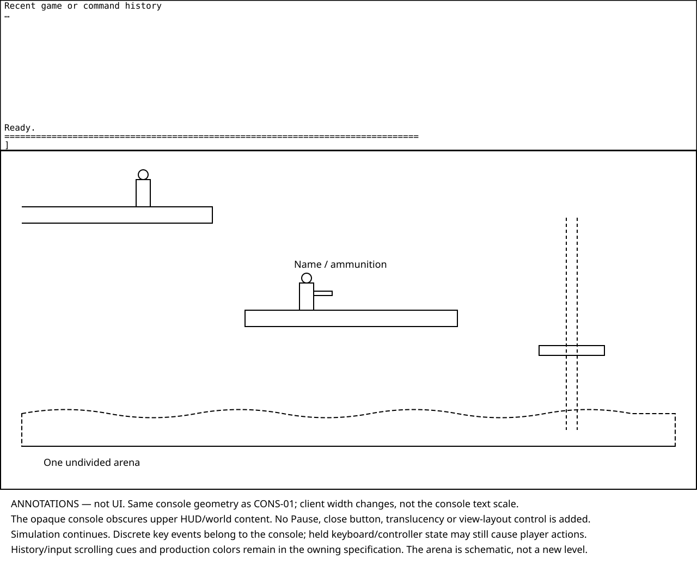

# CONS-02 wireframe — Console over gameplay

Representative viewport: 1280 by 900 debug client.
The console geometry matches CONS-01 and overlays the active shared arena frame.
The screen has no mobile layout, so this single desktop wireframe covers the implemented overlay.

The monochrome drawing preserves the console's opaque overlap, not a new arena layout or pause state. Colors and scrolling cues remain in the [owning screen contract](../console-gameplay.md) and [design system](../../design.md); external annotations are not UI.

The console obscures the upper arena and receives text input and discrete key-down events instead of routing those events to the gameplay context.
Key-down and key-up events still update shared held-keyboard state, and controller controls still read shared controller state. Either state may continue to cause player actions while the simulation continues.
The console does not provide a gameplay view-layout control.

Current representative: [SS-014 — console over active play](../../design/screenshots/README.md#current-ss-014).
