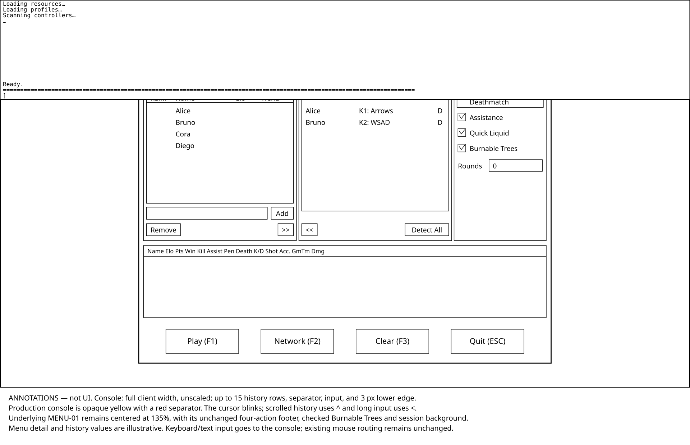

# CONS-01 wireframe — Console over menu

Representative viewport: 1920 by 1080 px desktop client.
The console sits against the top of the visible client area.
The screen has no mobile layout. The [current screen contract](../console-menu.md) retains the `MENU-01` four-action footer below the console overlay.

The SVG is monochrome; external annotations explain the existing opaque console and underlying session background without adding UI. Production styling remains in [docs/design.md](../../design.md).

The console surface is `#EEDD00`.
The input cursor blinks.
The complete client width determines the console width.
The console remains unscaled and does not inherit the menu transform.
The fixed 850 by 700 logical menu canvas remains centered at the 135% scale cap under the console.
The visible Game Settings area below the console must show the checked Burnable Trees checkbox in the representative default setup.
The visible target footer below the console must use the equal-width `Play (F1)`, `Network (F2)`, `Clear (F3)`, and `Quit (ESC)` coordinates documented by `MENU-01`.
The visible client below the console uses the same selected still, cover crop, blur, and 55% scrim as `MENU-01` in the same session.

Current representative: [SS-013 — console over the four-action footer](../../design/screenshots/README.md#current-ss-013). The [original issue #38 recipe](../../design/screenshots/legacy.md#ss-013) is historical.
