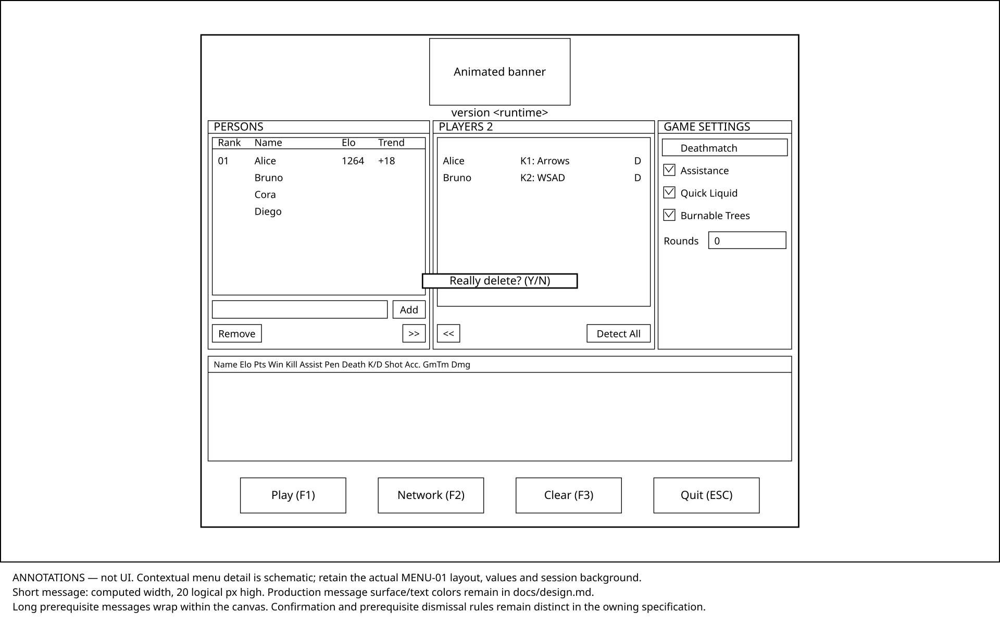

# MENU-02 wireframe — Menu blocking message

Representative viewport: 1920 by 1080 px desktop client.
The background is the complete `MENU-01` layout, including the distinct four-action footer, under the [current screen contract](../menu-message.md).
The strip uses message-dependent logical width, scales with the menu, and stays centered.
The screen has no mobile layout, so this single desktop wireframe covers all implemented message variants.

Monochrome shapes represent the existing message and menu surfaces. The external annotation region is not UI; production pink surface, red text and the 2 px black message frame remain governed by [docs/design.md](../../design.md).

The implementation must render short messages, including `Really delete? (Y/N)`, on one 20-logical-pixel high line.
The implementation must calculate a short panel width from the complete message length.
Long messages may wrap at word boundaries within the logical canvas and must grow the panel by one 16-logical-pixel text row for each additional line. Sentence boundaries should be preferred where practical.
The implementation must keep the approved three-panel `MENU-01` canvas unchanged behind the message.
The visible target footer must use the equal-width `Play (F1)`, `Network (F2)`, `Clear (F3)`, and `Quit (ESC)` coordinates documented by `MENU-01`.
The visible Game Settings panel must show the checked Burnable Trees checkbox in the representative default setup.

Start-prerequisite variants:

- No level: `No usable levels loaded. Correct content/configuration, restart the application, then try again. Press any key.`
- No weapon: `No weapons enabled. Correct content/configuration, restart the application, then try again. Press any key.`
- Both missing: `No usable levels loaded. No weapons enabled. Correct content/configuration, restart the application, then try again. Press any key.`

The `Really delete? (Y/N)` confirmation is the representative state for this wireframe.
The confirmation must accept `A` or `Y` as yes and `N` as no.
The start-prerequisite variants must remain available as documented states.
Any keyboard key dismisses a start-prerequisite variant and reveals the unchanged usable menu.
The application consumes the start-prerequisite dismissal key without activating its normal menu action.
Mouse actions do not dismiss a start-prerequisite variant.
The window close action remains available.
Other message variants replace only the message text and computed width.
The selected background filename, cover crop, blur, scrim, menu scale, and keyline remain unchanged from the underlying `MENU-01` session.

Planned representative screenshot for downstream issue #38: [`SS-002`](../../design/screenshots/legacy.md#ss-002).
