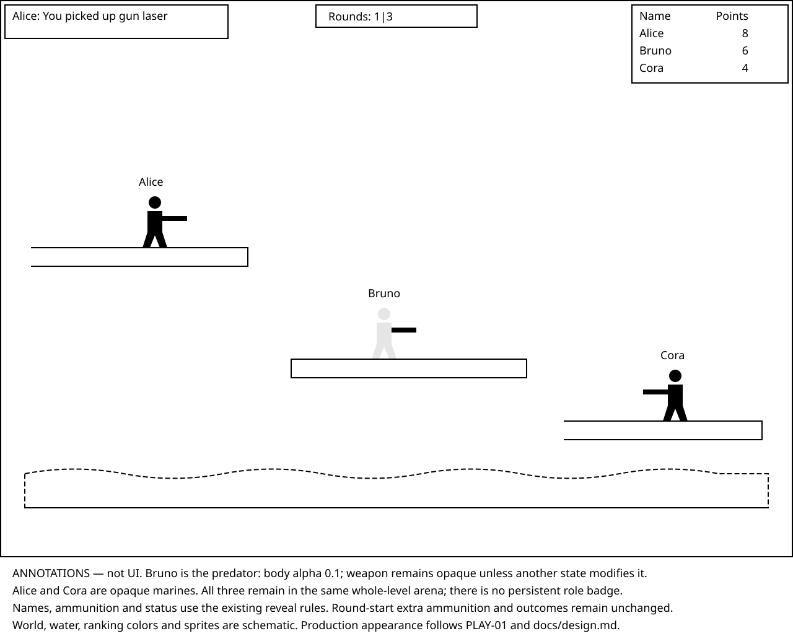

# MODE-01 wireframe — Predator gameplay

Representative viewport: 1280 by 900 debug client.
This state uses the undivided PLAY-01 shared arena geometry for every supported player count.
The role cue materially changes a player, so this state has its own wireframe and evidence entry.

The body/weapon opacity distinction is structural. Role explanations stay outside the client as annotations, not new persistent gameplay badges. The [owning screen contract](../mode-predator.md), PLAY-01 and [design system](../../design.md) retain authority over actual sprites, colors and status visibility.

All marines and the predator remain in the same gameplay view.

Representative screenshot: [`SS-007`](../../screenshots/README.md#ss-007).
