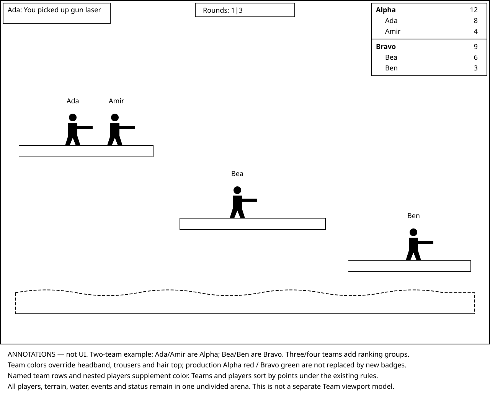

# MODE-02 wireframe — Team gameplay and ranking

Representative viewport: 1280 by 900 debug client.
The representative state uses two teams and four players.
Three-team and four-team variants add team groups without changing the layout model.
Every team and player remains in one undivided arena view.

The monochrome SVG records named team groups and nested players. External annotations identify apparel-color meaning without adding an in-world team label. Production team colors and the unchanged shared arena follow the [owning screen contract](../mode-team.md) and [design system](../../design.md).

Representative screenshot: [`SS-008`](../../screenshots/README.md#ss-008).
