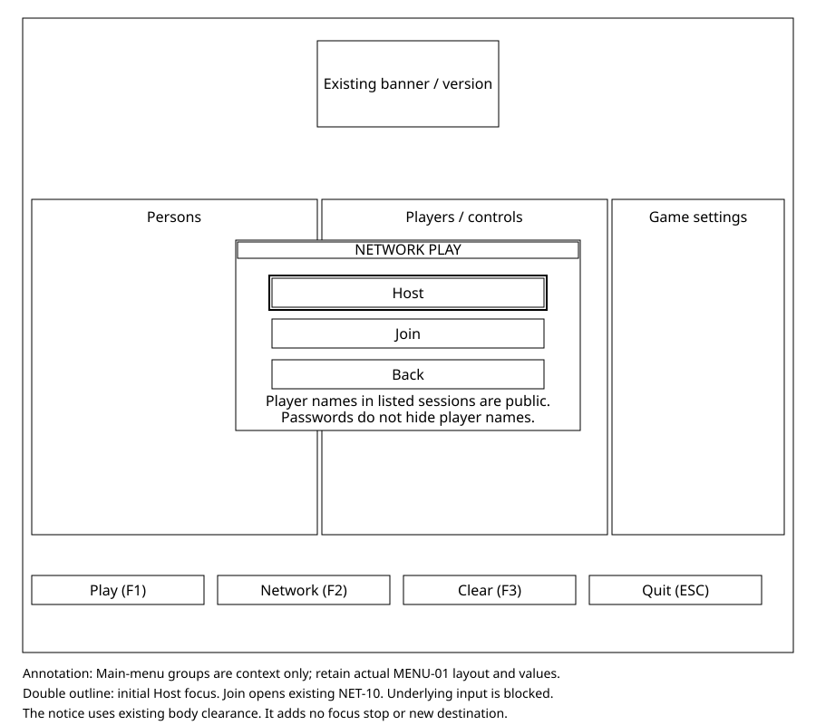

# NET-01 wireframe — Network entry

Representative desktop context: 1920 by 1080 px. The 850 by 700 logical canvas uses the 135% scale cap over the persistent blurred and scrimmed menu background. The SVG depicts logical-canvas relationships with external annotation space.

This reuses the current canonical SVG unchanged. The [functional owner](../network-entry.md) and [NET-01 presentation owner](../../design/screens/NET-01.md) define the compact Host/Join/Back modal over the actual menu, without the former explanatory scope/platform/limit text. Join opens NET-10; Direct connect remains there. The earlier full-task illustration and planned/unimplemented status are historical only.

- Focus order is Host, Join, Back, with Host initially focused.
- The modal adds no discovery, account, dedicated-administration or matchmaking action and does not receive endpoint fields.
- Significant unavailable and return variants remain in the screen specification.
- The current presentation owner defines the centered 380 by 210 logical px popup, 300 by 32 actions and 13 px action gaps. The older full-panel margin guidance does not override it.

Planned representative screenshot: [`SS-015`](../../screenshots/README.md#ss-015).
