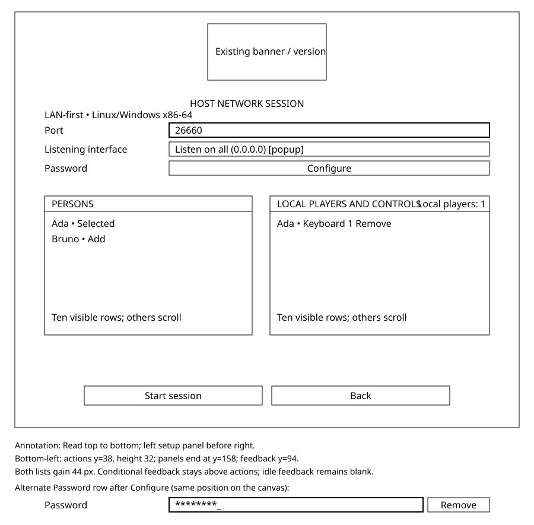

# NET-02 wireframe — Host setup

Representative desktop context: 1920 by 1080 px with the scaled 850 by 700 retro canvas. The current SVG depicts logical-canvas relationships with external annotations.

The [functional owner](../network-host-setup.md) and [NET-02 presentation owner](../../design/screens/NET-02.md) govern optional password setup, wildcard/multiple explicit listening selection, hosted capacity, taller lists and current footer. Existing variants remain [wildcard popup NET-02-LA](../../design/wireframes/NET-02/NET-02-LA.svg), [explicit popup NET-02-LE](../../design/wireframes/NET-02/NET-02-LE.svg) and [pending startup NET-02-P](../../design/wireframes/NET-02/NET-02-P.svg). Empty, invalid and enumeration-failure states retain their owning contracts rather than new diagrams.

- Start session is enabled only when Port, `Listening interface`, and local-player configuration are valid; its disabled reason remains visible.
- Port has initial focus.
- `Listening interface` follows Port in keyboard and controller focus order.

Historical single-address selector guidance — superseded

These earlier selector rules must not override current `Listen on all`, independent explicit choices, eligible public addresses or popup-closing behavior in the owners above.

- First entry selects `127.0.0.1 (Same machine)` by default.
- The expanded selector lists loopback and every currently eligible assigned private RFC1918 IPv4 literal once.
- The expanded selector excludes wildcard, unspecified, public, multicast, link-local, unassigned, network, and broadcast addresses.
- Confirm opens or accepts the selector; directional input changes the highlighted option; Back closes the open selector without leaving the screen.

- An explicit single LAN selection shows the complete eligible assigned private RFC1918 IPv4 literal and `Private LAN` in the collapsed selector.
- Each option uses one row, and a long scope label clips only after the complete IPv4 literal.
- The expanded list overlays lower content, keeps the split-panel top edge fixed, and scrolls inside the canvas when necessary.
- Explicit Start revalidates the selected addresses before startup begins.
- A stale selection returns to editable setup with `Selected listening interface is no longer available. Choose another interface.` and no service attempt.
- Pending startup shows `Starting session…` and `Startup can take up to 10 seconds.`.
- Pending startup locks setup and shows Cancel as the only action.
- Accepted Cancel shows `Cancelling session…` with no activatable control until cleanup completes.
- Completed Cancel returns to editable setup with all values retained and no listener.
- Pending startup never shows listening, readiness, connection, admission, or playable copy.
- Failure variants and Retry/Edit setup/Return destinations remain in the screen specification rather than separate wireframes.
- An invalid host manifest uses the exact blocking reason in the screen specification, disables Retry for the application session, and leaves no listener or session.
- The setup body is flexible between fixed header and footer regions. Both lists scroll vertically under fixed headings, and status grows upward without covering the setup or actions.
- Persons and Local Players provide person selection and control assignment without a profile selector, profile column, profile value, or profile-editing action.
- A profile or cosmetic difference does not create a setup warning or prevent Start session.
- Add and Remove change the local-player count only in editable setup.
- Start session finalizes the displayed count and ordered slot set for the attempt.
- Starting and Cancelling lock slot count and order.
- Cancel, failure, Edit setup, and eligible Retry retain the selected address while it remains eligible.
- Enumeration and selection do not discover peers or change host, Docker, firewall, route, NAT, or port-forwarding configuration.

Current representative: [SS-016 — editable Host setup](../../design/screenshots/README.md#current-ss-016).
