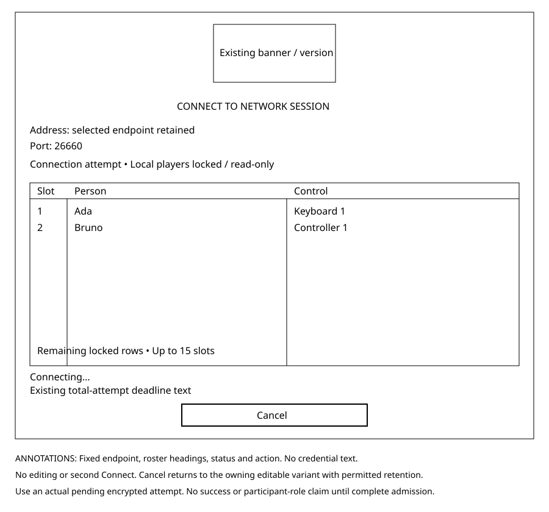

# NET-03 wireframe — Join connecting

Representative desktop context: 1920 by 1080 px with the scaled 850 by 700 retro canvas. The SVG depicts logical-canvas relationships with external annotation space.

This reuses the current canonical SVG unchanged. The [functional owner](../network-join.md) and [NET-03 presentation owner](../../design/screens/NET-03.md) govern common optional/required Password, selector-free Direct and locked selected-session context. Editable structural variants remain [NET-03-P common Direct](../../design/wireframes/NET-03/NET-03-P.svg), [NET-03-E selected player-hosted](../../design/wireframes/NET-03/NET-03-E.svg) and [NET-03-B selected dedicated](../../design/wireframes/NET-03/NET-03-B.svg). Connecting does not show credential text or promise a role. The earlier planned/unimplemented status is historical.

- The endpoint and two local players remain visible while the attempt is pending.
- The representative setup uses a project-local host process bound to `127.0.0.1:26660` that accepts the connection and withholds a complete terminal admission result until after capture.
- The capture setup does not change host, Docker, firewall, route, NAT, or port-forwarding configuration.
- This same-machine state complements the explicit private-LAN selection in `SS-016` and does not replace that coverage.
- The screen must not claim connection or lobby admission before the guest validates the exact final `admitted` confirmation, valid host-clock calibration, and one complete valid initial full snapshot.
- The guest must receive all three success inputs strictly before the single total deadline.
- The initial snapshot must match the confirmed participant identity and ordered owned-player identities.
- The snapshot production time must be valid under the host-clock calibration result.
- Inline validation remains on editable `NET-03`. Cancel returns there with endpoint and players retained.
- Complete host rejections use the exact identifier order in the screen specification; malformed or inconsistent complete host messages use the fixed invalid-host-message outcome.
- Without a complete response, name-resolution failure, unreachable or refusal, incomplete admission, and timeout use the exact order and copy in the screen specification.
- User copy is fixed and never displays peer-supplied release IDs, manifest paths, credentials, policy values, or payloads.
- Retry, Edit setup, Return to Network, and other failure variants remain in the screen specification.
- The endpoint header and connecting footer remain fixed. Local-player rows use the flexible middle region and scroll under fixed headings.
- Local setup provides person selection and control assignment without a profile selector, profile column, profile value, or profile-editing action.
- Profile and cosmetic differences do not produce compatibility copy or block Connect.
- Editable setup provides Add and Remove controls for the pre-admission local-player count.
- Connect finalizes the displayed count and ordered slot set for the attempt.
- Connecting locks the slot count and order and shows no active Add, Remove, or Transfer action.
- Focus remains on Cancel while the loopback attempt is pending.
- Focused revalidation must show that Cancel restores the retained endpoint and two slots.
- Separate focused revalidation must show `Connection timed out.` when the controlled host withholds every complete terminal result through the original 10-second deadline.

[Legacy SS-017 Connecting recipe](../../design/screenshots/legacy.md#ss-017). The [current NET-03-P Direct setup capture](../../design/screenshots/README.md#current-net-03-p) precedes Connect and does not show this state.
