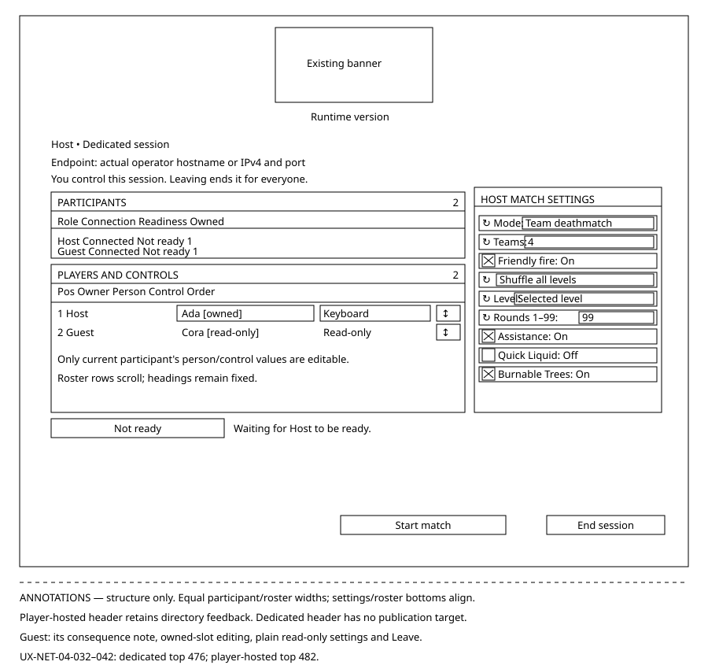

# NET-04 wireframe — Host waiting in lobby

Representative desktop context: 1920 by 1080 px with the scaled 850 by 700 retro canvas. The existing representative scenario below uses 3 participants, 6 players and one unready guest; the canonical SVG uses schematic example rows, not a replacement capture fixture.

The [functional owner](../network-lobby.md) and [NET-04 presentation owner](../../design/screens/NET-04.md) govern the canonical SVG, including aligned membership/settings regions, owned versus read-only controls, hosting-specific context, publication feedback and eligible solo Start.

- Role, Connection, Readiness, and owned-player count occupy separate textual columns.
- Every roster slot shows its authoritative position, owner, person, and control.
- Guests see host settings and another participant's slots as read-only.
- Configuration, roster, or membership changes clear every participant's readiness and refresh the visible disabled reason.
- A Reconnecting row retains readiness but blocks Start by participant name. Ambiguous isolation stays in reconnect for the full deadline.
- Lobby removal batches clear all readiness, perform no winner evaluation, retain completed or interrupted results, and label departed rows. Host-alone, Leave/End confirmations, and other variants remain in the specification.
- A completed result appears in `NET-06` and then remains available in this following lobby.
- An active-round or non-final-summary interruption returns here directly without `NET-06`.
- The interrupted state shows `Session only • Interrupted • No winner` and retains the last completed-round outcome when one exists.
- Retained result state, match outcome, last completed-round outcome, and cumulative ranking use separate labels.
- The cumulative ranking leader does not receive a champion label or treatment.
- The settings area offers only the supported mode matrix, level plan, round limit 1–99, Assistance, Quick Liquid, and Burnable Trees.
- Invalid settings remain here with exact corrective copy and cleared readiness.
- Unavailable content blocks another Start match and leaves host-only End session available.
- The body gives approximately two thirds of its width to participants and roster content and one third to settings, with an 8-logical-pixel gap.
- Participant, roster, and retained-result rows scroll under fixed headings while the session header, disabled reason, and footer actions remain visible.
- Participant-owned rows expose person and control assignment without profile selection or profile values.
- Profile and cosmetic differences do not change readiness or Start eligibility.
- Each participant row contains its fixed admitted slots with person and control values.
- The current participant may edit person and control values only for its existing owned slots.
- The host may reorder the authoritative roster without changing player identity or ownership.
- The lobby has no Add, Remove, or Transfer player-slot action or interaction target.
- Person, control, and host roster-order edits clear every participant's readiness.
- Leave or authoritative expiry removes all slots owned by that participant.

Planned representative screenshot: [`SS-018`](../../screenshots/README.md#ss-018).

Review correction: the representative lobby now exercises retained four-team/Friendly Fire preferences through Deathmatch and Predator with readiness cleared. Non-Team controls have no targets. [NET-04-R](../../design/wireframes/NET-04/NET-04-R.svg) adds the explicit retained-results structure (`SS-025`): approximately 215 logical pixels for historical results beneath current membership, bounded winner-count headings with `See outcome rows`, and complete scrollable outcome identities before existing results. Fixed headings and actions remain visible; removed winners remain only in history. The owning [lobby specification](../network-lobby.md) defines behavior; corrected captures are pending.
