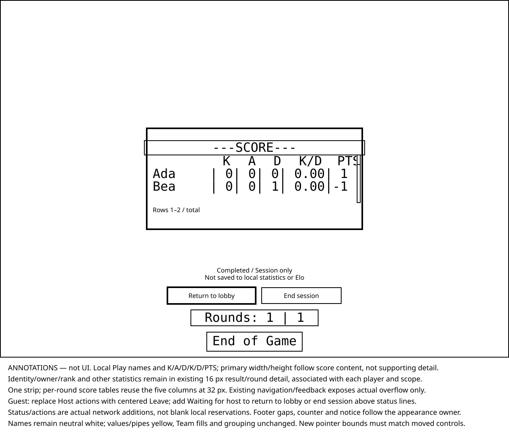

# NET-06 wireframe — Completed final three-round summary

Representative viewport: 1280 by 900 px. The current common final shell retains the final arena context behind the shared curtain and translucent score surfaces.

This reuses the current canonical SVG unchanged. The [common final-screen contract](../overlay-game-over.md#common-final-screen-contract), [NET-06 presentation binding](../../design/screens/NET-06.md) and [shared final presentation](../../design.md#shared-final-presentation) supersede the legacy separate summary shell, heading/allocation example and planned/unimplemented status. Current required result content, outcome identity, navigation, role-specific actions and persistence meanings below remain binding under their owners. External annotations are not UI; no legacy menu/card shell is restored.

- The exact `Session only` label is visible with the authoritative final results.
- This screen presents only a `Completed` result.
- The match outcome equals the configured final-round outcome.
- Match outcome, last completed-round outcome, and cumulative ranking use separate labels.
- The cumulative ranking leader does not receive a champion label or treatment.
- Final-summary departure never reevaluates the completed outcome; retained rows use `Departed`. Starting a new match clears this set, while intentional host end or host-local supervised failure discards the host result.
- Guest Leave, full-deadline reconnect, and intentional host End session variants and confirmations remain in the specification.
- Keyboard/controller focus is explicit and does not depend on color.
- An interrupted result enters `NET-04` directly and never appears here.
- The result provides all completed match, round, player, and applicable team fields from issue #32.
- Ranking uses labeled columns and textual rank, team, winner, No winner, and Departed values.
- The panel keeps a fixed identity header and action footer around a vertically scrolling result viewport.
- Wide result tables provide an internal horizontal scroll control and keep their column headings visible.

Planned representative screenshot: [`SS-020`](../../screenshots/README.md#ss-020).

Review correction: use 14 surviving Predator winners with maximum-length names and a departed winning guest. Bound fixed outcome headings with winner counts and `See outcome rows`; insert complete scrollable match/round outcome rows before existing result sections. Keep full names, identity, scope and departure state accessible independently of current membership. Preserve fixed headings/actions and UTF-8 boundaries. The owning [summary specification](../network-summary.md) defines the corrected layout; replacement evidence is pending.
