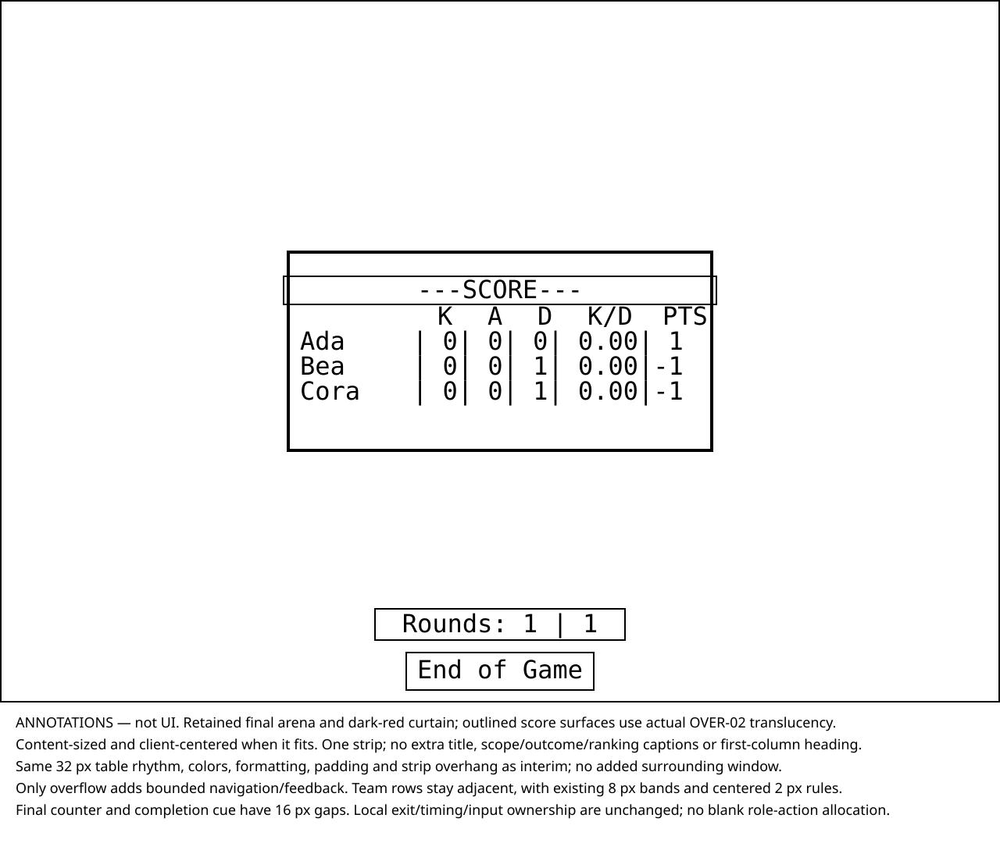

# OVER-03 wireframe — Game-over summary

Representative viewport: native 1280 by 900 client; short completed local result.

The existing SVG now shows the actual interim-style, content-sized centered panel with exactly one `---SCORE---` strip. The [functional contract](../overlay-game-over.md#common-final-screen-contract), [screen binding](../../design/screens/OVER-03.md) and [appearance owner](../../design.md#shared-final-presentation) retain authority. No added SCORE title, Local Play, outcome/ranking captions, Player / team heading or empty network footer appears. The final counter and End of Game remain separate below the table. A larger Team result uses bounded existing navigation, not an additional surrounding window. External SVG annotations are not UI.

Historical illustration guidance — superseded, not current layout requirements

The following notes retain the earlier illustration's context. Its top-center counter, backing overlap, oversized-panel allocation and Predator exclusion must not override the current owners linked above.

The representative visual table is the oversized final limited four-team, 15-player variant over the undivided shared arena.
The workflow is final and does not start another round.
This material exit state has its own wireframe and evidence entry.
The screen has no mobile layout, so this single desktop wireframe covers the target overlay.

The representative state uses a one-round limited Team match with 15 players across four teams.
Alpha, Bravo, and Charlie each have four nested player rows.
Delta has three nested player rows.
The top-center final round counter and `---SCORE---` use the same 32 px character height.
The counter keeps its current content and final-round values.
The opaque black counter backing grows from the measured complete text width, including multi-digit final values.
The backing keeps visible inner space around the counter and contains every character.
The oversized representative panel uses the complete available middle height before it overlaps the counter backing.
The overlap uses only the minimum required vertical depth.
The overlap does not reach or reduce the contrast of any counter character or score content.
Each team row touches its nested player rows without an internal gap.
Each adjacent group boundary uses the same 8 px band as non-final `OVER-02`.
Each band contains a 2 px white rule at 70% opacity with 3 px of clear space above and below it.
The rule spans the score-table width and does not cross the panel padding.
The final Team panel adds one 8 px band for each adjacent team boundary.
The `End of Game` notice uses white 32 px score-summary text on a solid blue rectangle.
The notice keeps at least 16 px of horizontal text padding and 8 px of vertical text padding.
The notice aligns to the horizontal center of the client.
The notice bottom edge is 16 px above the bottom client edge.
At least 16 px of clear space separates the notice from the score panel.
The notice does not overlap, clip, cover, replace, or reduce score content.
The fitted variant keeps the score panel client-centered when that position provides at least 16 px between the panel and counter backing.
The fitted variant does not overlap the counter backing.
The oversized variant may overlap the counter backing after it uses the complete available middle height.
The oversized variant keeps the counter text visually above intersecting backing surfaces.
The oversized variant does not wrap, truncate, scale down, clip, or remove counter text or score content.
The final limited Deathmatch variant uses the same top counter, middle score panel, and bottom `End of Game` notice regions.
The Deathmatch score table remains separator-free.
Only the Team variant uses team-group separator bands.
Predator, non-final, unlimited, and active-round overlays do not use this changed final-summary presentation.
The final state does not show `Game Over`, `Exit`, or `Return to menu`.

Current representative: [SS-012 — compact Local Play final](../../design/screenshots/README.md#current-ss-012).
