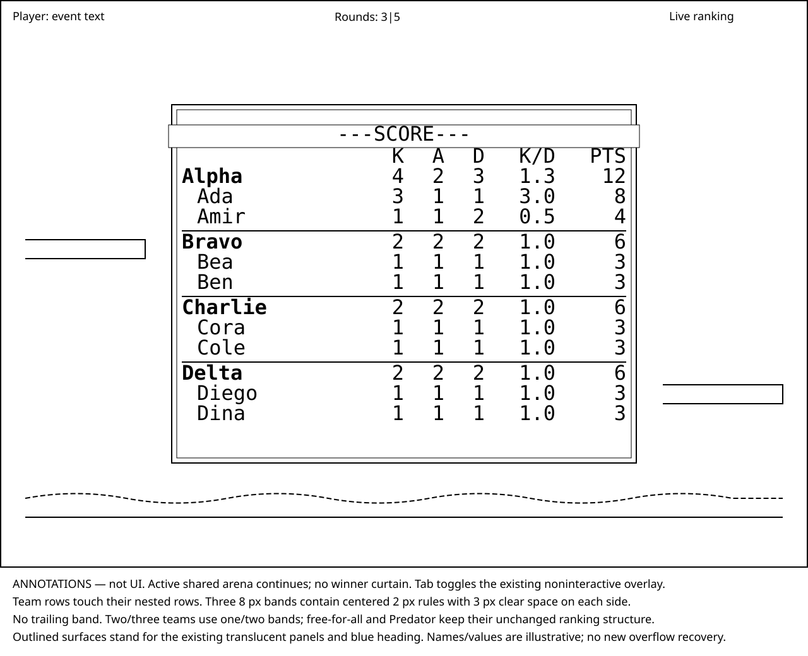

# OVER-01 wireframe — Score-tab overlay

Representative viewport: 1280 by 900 debug client.
The panel size depends on name length, ranking row count, and Team group count.
The screen has no mobile layout, so this single desktop wireframe covers the implemented centered overlay.

Monochrome panel outlines represent the existing translucent white outer surface, blue inner surface and blue heading strip. External annotations are not UI. The [owning screen contract](../overlay-score-tab.md) and [design system](../../design.md) retain exact sizing calculations, production appearance and noninteractive overlay behavior; the SVG is schematic.

No winner curtain appears in this state.
The representative Team state uses four teams and two nested players per team.
Each team row touches its nested player rows without an internal gap.
Each adjacent group boundary uses an 8 px band.
Each band contains a 2 px white rule at 70% opacity with 3 px of clear space above and below it.
The rule spans the score-table width and does not cross the panel padding.
The separator adds 8 px to the panel height for each of the three group boundaries.
Two-team and three-team states use the same treatment with one and two separator bands.
Free-for-all and Predator structures use the unchanged centered overlay model.

Representative screenshot: [`SS-010`](../../screenshots/README.md#ss-010).
