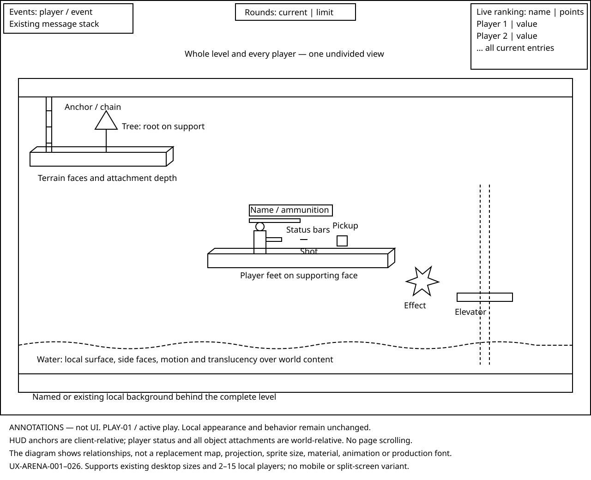

# PLAY-01 wireframe — Live shared arena gameplay

Representative viewport: 1280 by 900 debug client.
The client dimensions are fluid, but the overlay anchors remain screen-relative.
The screen has no mobile layout, so this single desktop wireframe covers the shared arena layout.
The layout applies to Deathmatch, Predator, and Team deathmatch with two through 15 players.

This reuses the current canonical SVG unchanged. The [PLAY-01 presentation owner](../../design/screens/PLAY-01.md) and [common arena contract](../play-fullscreen.md#common-arena-presentation-contract) govern world attachments, layering, status and temporal presentation. The schematic preserves relationships, not a replacement level or production appearance; external annotations are not UI.

Start variant: blue-dark fade plus yellow spiked location rings.
Optional variants: FPS at upper right, ranking hidden, round counter absent.
Entry guard variant: if no successfully loaded level or no enabled weapon exists, no arena frame is created.
The entry guard keeps MENU-02 over MENU-01, so it has no separate PLAY-01 visual layout.
The representative PLAY-01 evidence must use a valid configuration.
F2 does not change this layout.
Mode, player count, score, result, sudden-death, and console variants do not create another arena view.

The [current AP-L / SS-003 capture](../../design/screenshots/README.md#current-ss-003) shows six living players on unmirrored Duel 16 after the Local Play fade. The [matching AP-N Guest representative](../../design/screenshots/README.md#current-ss-019) is still missing.
