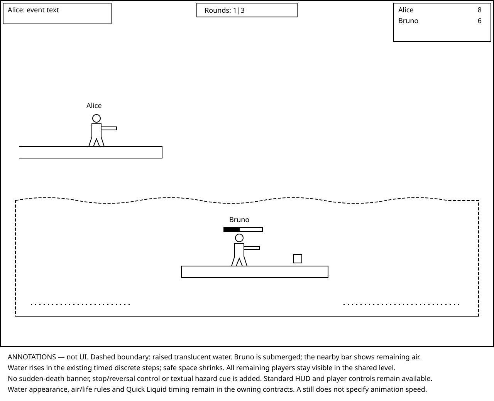

# PLAY-05 wireframe — Sudden-death rising water

Representative viewport: 1280 by 900 debug client.
This state uses the PLAY-01 shared arena and overlay anchors.
The raised environmental boundary materially changes the task, so this state has its own wireframe.

The water outline is a monochrome structural cue, not an on-screen label or new water material. External annotations are not UI. The [owning screen contract](../play-sudden-death.md), PLAY-01 and [design system](../../design.md) retain authority.

The water rises in timed discrete steps.
The state has no sudden-death banner.
All remaining players stay visible in the shared arena.

Representative screenshot: [`SS-009`](../../design/screenshots/legacy.md#ss-009).
